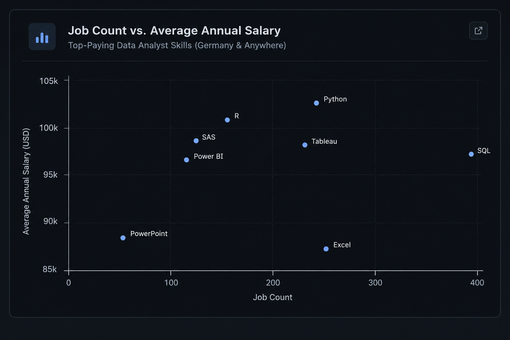

# Introduction
This project explores the relationship between skill demand 📈 and average annual salary 💰 for Data Analyst 📊 positions. The goal 🎯 is to identify which skills offer the highest salaries and which are most frequently requested by employers.

🔍 Check the sql queries here: [project_sql folder](./project_sql/)

# Background & Motivation

As a teenager exploring potential career paths in cs and engineering, I often found myself overwhelmed by the range of skills and specializations employers look for. I created this project to approach that uncertainty through data, identifying the most in-demand and highest-paying skills to help guide my learning journey and better understand which technical fields might suit my interests. 

As a next step, I plan to build another database using newer job postings to compare the findings and explore how skill demand and salaries have evolved over time.


# Research Questions

- Which skills are associated with the highest average annual salaries?

- Which skills appear most frequently in job postings?

- Does higher job demand necessarily translate into higher salaries?

# Tools Used

For this project, I used several tools to query, analyze, and present the data:

- **SQL**: Used to query the database, filter job postings, and extract meaningful insights.
- **PostgreSQL**: Used as the database management system to store and manage the job posting data.
- **Visual Studio Code**: My primary environment for writing and executing SQL queries.
- **Git & GitHub**: Used for version control, documenting my work, and sharing the project.

# Analysis

### Key Findings

*This scatter plot compares the job count and average annual salary of the eight selected Data Analyst skills, highlighting the differences between market demand and earning potential.*

- **Python** ranked first in average annual salary, reaching $101,397.
- **SQL** had the highest job count, appearing in 398 job-skill records.
- **R** followed Python with an average annual salary of $100,499, despite having considerably fewer job postings.
- **Excel** had the lowest average annual salary at $87,322.
- Higher job demand did not necessarily translate into higher salaries. Python, for example, offered a higher average salary than SQL despite appearing in fewer job postings.
- Programming and analytical tools dominated the highest-paying positions in the dataset.
### code
```sql
WITH top_paying_jobs AS(
    SELECT  job_id,
            job_title,
            name AS company_name,
            salary_year_avg
    FROM job_postings_fact
    LEFT JOIN company_dim ON job_postings_fact.company_id = company_dim.company_id
    WHERE job_title_short = 'Data Analyst' AND 
        job_location IN ('Germany', 'Anywhere') AND 
        salary_year_avg IS NOT NULL
    ORDER BY salary_year_avg DESC
)

SELECT
        Count(top_paying_jobs.job_title) AS job_count,
        skills,
        ROUND(AVG(salary_year_avg),0) AS anual_salary_skill_avg
FROM top_paying_jobs
LEFT JOIN skills_job_dim ON top_paying_jobs.job_id = skills_job_dim.job_id
LEFT JOIN skills_dim ON skills_dim.skill_id = skills_job_dim.skill_id
Where skills IS NOT NULL
GROUP BY skills_dim.skills
HAVING  Count(top_paying_jobs.job_title) > 50
ORDER BY anual_salary_skill_avg DESC

```


# Conclusion

This analysis revealed an interesting contrast between skill demand and earning potential. While SQL appeared most frequently in job postings, Python offered the highest average annual salary.

The findings provided a useful starting point for understanding the data analytics job market and identifying promising skills to invest in.

However, salary alone shouldn't determine which skills to pursue. Job demand, personal interests, and long-term career opportunities are equally important considerations.

I intend to revisit this analysis using newer job postings to identify how employer requirements and the value of different skills have evolved over time.
